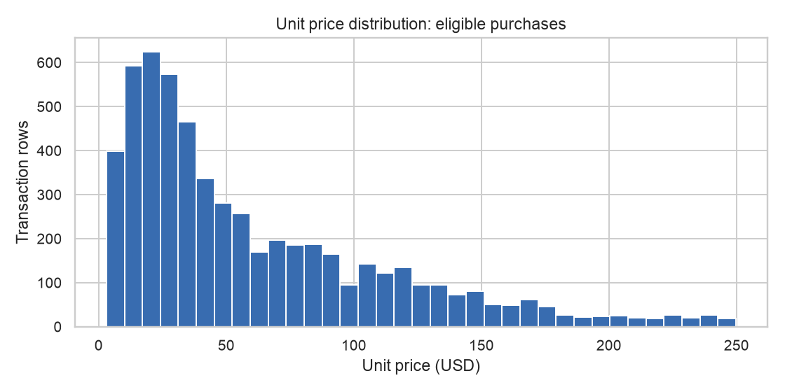
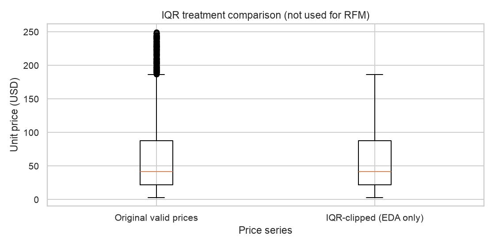
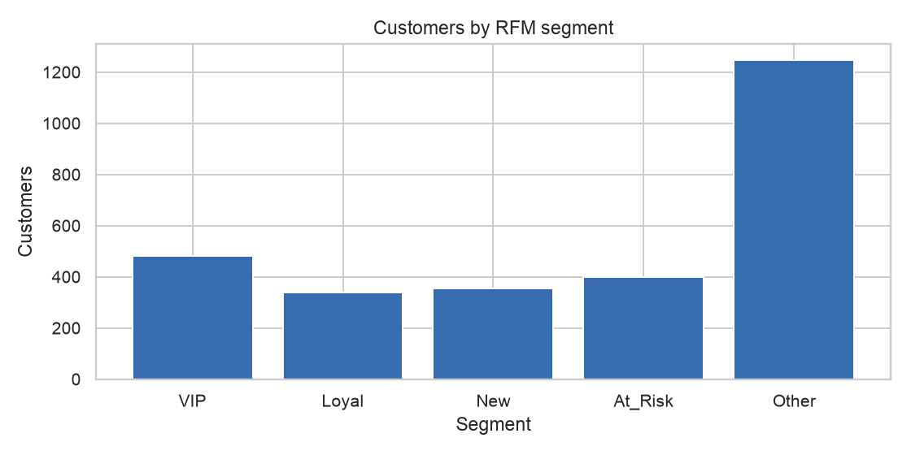
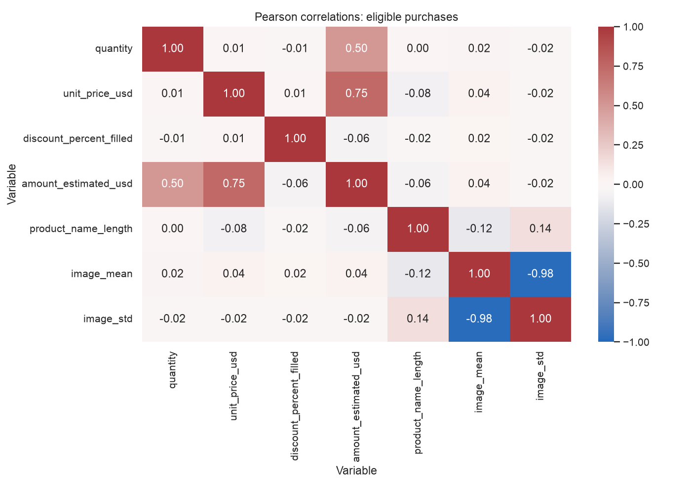
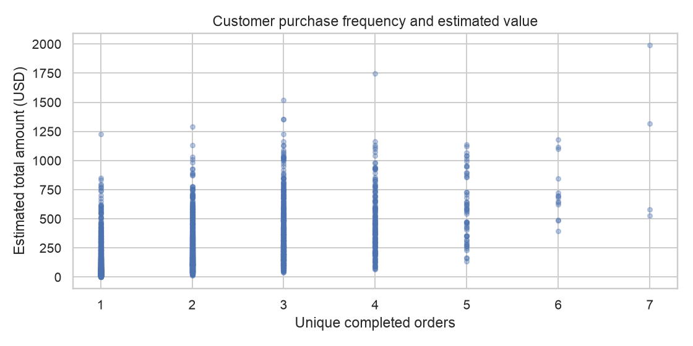
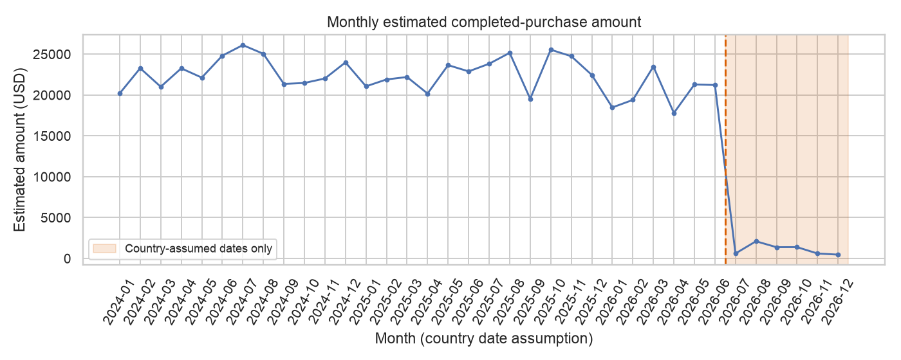
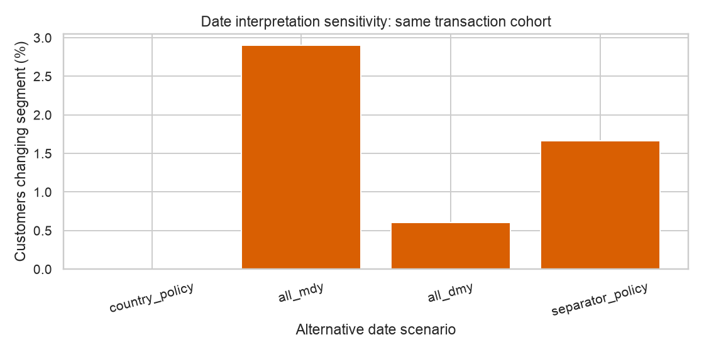

# 이커머스 상품·고객 분석 결과

## 분석 범위

원본 12,180행 → 정제 12,000행 → 유효 완료 구매 5,700행, 고객 2,823명.
대상 추정 금액은 675,801.92 USD이며, RFM 기준일은 2026-12-05이다.
모호하지 않은 날짜의 최대일은 2026-06-30다. 국가 가정 때문에 기준일이 158일 확장됐다.
이 최대일 이후 거래 52행과 차트 음영 구간은 국가 가정으로 해석한 날짜에서만 나온다. 실제 매출 급감이나 미래 완료 구매의 증거가 아니다.
출처 확인일 2026-11-25보다도 기준일이 늦다. Recency 절댓값은 가정한 기준일의 영향을 받으며 실제 미구매 기간으로 단정하지 않는다.
거래는 Kaggle의 합성 학습 데이터(CC0), 이미지는 AI 생성 대표 스케치다.
출처: [Kaggle](https://www.kaggle.com/datasets/afaqkhan091/messy-e-commerce-sales-dataset-2026).
확인 필요 거래 1,653행의 항목은 원본을 유지한 채 별도 CSV에 남겼다.

## 통계와 IQR

- 단가 평균 61.48, 중앙값 42.04, 표준편차 52.61 USD.
- 단가 사분위수: Q1 21.89, Q3 87.76 USD. 평균·중앙값과 분포를 함께 보아 고가 관측값의 영향을 검토한다.
- IQR 이상치 200행(3.51%). EDA용 클리핑 시 평균 60.38 USD.
- 고가의 정상 구매를 삭제하지 않도록 RFM은 원래 유효 금액을 유지한다.
- 단가/금액 Pearson r=0.749, 수량/금액 r=0.503.
  두 관계는 금액 산식에 포함된 변수 간 관계로, 독립적인 인과효과를 뜻하지 않는다.
- 이미지 평균/표준편차 r=-0.980. 합성 선화의 구조이며 실제 상품 수요의 근거가 아니다.

## RFM과 실행 가설

R은 역방향 평균 백분위 순위×4의 올림, F는 구매횟수 1/2/3/4회 이상, M은 금액 평균 백분위 순위×4의 올림이다.
동점 점수는 같으며 그룹 크기를 강제로 같게 만들지 않는다.
우선순위: VIP(R≥3,F≥3,M≥3) → Loyal(F≥3) → New(R≥3,F=1) → At_Risk(R≤2,F≥2) → Other.
R은 상대 순위이며 실제 최근 30일을 뜻하지 않는다. New는 관측 기간의 단일 구매 고객, At_Risk는 이탈 가설이다.

1. **VIP 유지 실험**
   - 근거: 482명(17.07%)이 추정 금액의 34.67%를 차지한다.
   - 실행: VIP에 우선 상담·혜택을 무작위 시험해 재구매율 유지·증대를 목표로 한다.
   - 검증: 원가·혜택 비용·후속 구매 데이터가 필요하다. 대조군 대비 이익 개선이 없으면 제안을 기각한다.
2. **이탈 위험 가설의 재구매 유도**
   - 근거: At_Risk 400명(14.17%)의 평균 Recency는 가정 기준일에서 642.6일이다. 기준일 연장 영향을 포함하므로 확정된 미구매 기간이 아니다.
   - 실행: 해당 고객에 재입고 안내·혜택을 무작위 시험해 재구매 반응 증대를 목표로 한다.
   - 검증: 날짜 원본·수신 동의·발송 이력·원가가 필요하다. 날짜 재해석이나 자연 재구매로 설명되면 가설을 재검토한다.
3. **단일 구매 고객의 두 번째 구매 실험**
   - 근거: New 354명(12.54%)의 완료 주문은 1회, 평균 추정 금액은 117.19 USD다.
   - 실행: 구매 상품 관련 안내를 시험해 두 번째 구매 전환율 증가를 목표로 한다.
   - 검증: 가입일·과거 기간 구매·구매 주기·후속 관측이 필요하다. 실제 신규가 아니거나 구매 주기가 길면 대상 선정이 틀릴 수 있다.

## 민감도와 한계

같은 거래 집합·같은 금액·공통 기준일 2026-12-06에서 날짜만 바꾸면,
최대 2.90%의 고객이 그룹을 바꾼다.
공통 기준일은 시나리오 전체 최대 날짜로, 본 분석 기준일과 다를 수 있다.
국가 규칙 충돌 1,482행은 대안에서도 복구하지 않으므로 결과는 포함된 거래 집합에 한정된다.
할인 전 금액으로 정의를 바꾸면 8명(0.28%)의 그룹이 바뀐다.
이는 할인 대치 오차 자체의 추정이 아니라 금액 정의 민감도다.
월별 절대 변화 합은 실제 매출 손실을 뜻하지 않는다. 효과 크기·LTV·실제 이탈·인과성을 입증하지 않는다.

## 차트

